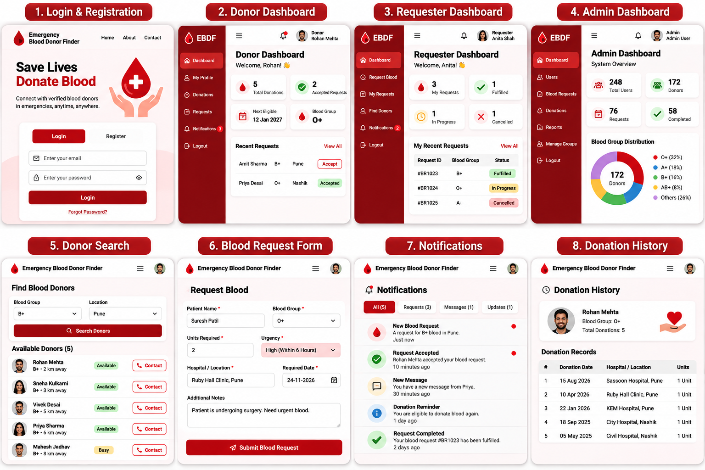
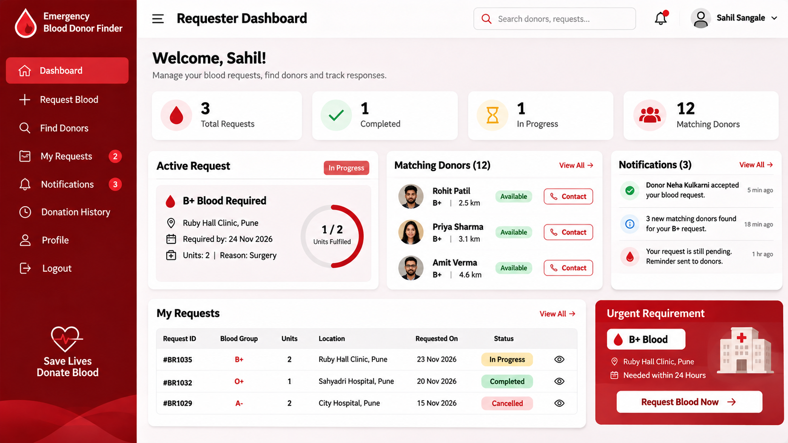

# 🩸 Emergency Blood Donor Finder

A full-stack web application built to connect blood donors with people who need blood during emergencies. The platform allows requesters to find compatible donors, create emergency blood requests, and track responses, while donors can manage their profiles and donation history.

## 🚀 Project Overview

Emergency Blood Donor Finder aims to simplify the blood donation process by providing a centralized platform for donors, requesters, and administrators.

## 🛠️ Technologies Used

### Frontend
- React.js 19
- JavaScript
- HTML5
- CSS3
- Vite

### Backend
- Core Java 21
- Java Servlets
- JDBC
- MVC Architecture

### Database
- Oracle Database 26ai Free

### Tools & Server
- Apache Tomcat 9
- Apache Maven
- Eclipse IDE
- VS Code
- Git & GitHub

## ✨ Key Features

### 👤 Authentication Module
- User Registration and Login
- Role-Based Authentication
- Secure Password Hashing
- Session Management

### 🩸 Donor Module
- Donor Profile Management
- Update Blood Group and Location
- Manage Donor Availability
- View Blood Requests
- Accept or Reject Blood Requests
- View Donation History

### 🏥 Requester Module
- Requester Dashboard
- Search Compatible Blood Donors
- Create Emergency Blood Requests
- Send Donor Invitations
- Track Blood Request Status
- View Donor Responses

### 🛡️ Admin Module
- Admin Dashboard
- Manage Donors and Requesters
- Manage Blood Requests
- Verify Donation History
- Manage User Accounts
- View Reports and Statistics
- Manage Application Settings

### 🔔 Additional Features
- In-App Notifications
- Blood Group Compatibility
- Request Tracking
- Protected Application Routes
- Server-Side Authorization

## 📸 Application Screenshots

### 1. Application Overview


### 2. Login & Registration


### 3. Donor Dashboard


### 4. Requester Dashboard


### 5. Admin Dashboard


### 6. Donor Search


### 7. Blood Request Form


*Note: These are illustrative UI mockups with sample data, not screenshots of verified live application functionality.*

## 📂 Project Structure

```text
EmergencyBloodDonorFinder/
│
├── database/
│   ├── 00_create_app_user.sql
│   ├── 00_install_or_upgrade.sql
│   ├── 01_create_schema.sql
│   ├── 02_stage2_migration.sql
│   ├── 03_verify_installation.sql
│   └── 04_promote_admin.sql
│
├── frontend/
│   └── React Application
│
├── screenshot/
│   ├── 00-all-pages-overview.png
│   ├── 01-login-registration.png
│   ├── 02-donor-dashboard.png
│   ├── 03-requester-dashboard.png
│   ├── 04-admin-dashboard.png
│   ├── 05-donor-search.png
│   └── 06-blood-request-form.png
│
├── src/
│   └── main/
│       ├── java/com/ebdf/
│       ├── resources/
│       └── webapp/
│
├── pom.xml
├── build-and-package.bat
├── build-and-package.ps1
└── README.md
```

## ⚙️ Installation and Setup

### 1. Prerequisites

Install the following software:

- JDK 21
- Node.js and npm
- Apache Maven
- Oracle Database 26ai Free
- Apache Tomcat 9
- Eclipse IDE

### 2. Clone the Repository

```bash
git clone https://github.com/sahilsangle24/Emergency-Blood-Donor-Finder.git
```

```bash
cd Emergency-Blood-Donor-Finder
```

### 3. Configure Oracle Database

Connect to Oracle Database using SQL*Plus.

Create the application user if it does not already exist:

```sql
@database/00_create_app_user.sql
```

Connect to the FREEPDB1 database as EBDF_APP and execute:

```sql
@database/00_install_or_upgrade.sql
@database/03_verify_installation.sql
```

### 4. Configure Database Connection

Set the database environment variables in PowerShell:

```powershell
$env:EBDF_DB_URL = "jdbc:oracle:thin:@//localhost:1521/FREEPDB1"
$env:EBDF_DB_USERNAME = "EBDF_APP"
$env:EBDF_DB_PASSWORD = "YOUR_DATABASE_PASSWORD"
$env:EBDF_DB_DRIVER = "oracle.jdbc.OracleDriver"
```

Never upload actual database credentials to GitHub.

### 5. Run React Frontend

```bash
cd frontend
npm ci
npm run dev
```

Open:

```text
http://localhost:5173
```

### 6. Build Java Backend

Return to the project root:

```powershell
.\build-and-package.ps1
```

Alternatively:

```bash
mvn clean package
```

### 7. Deploy on Apache Tomcat 9

The generated WAR file:

```text
target/EmergencyBloodDonorFinder.war
```

Deploy it to Tomcat's `webapps` directory and start the server.

Application URL:

```text
http://localhost:8086/EmergencyBloodDonorFinder/
```

Use the port configured in your Tomcat installation.

## 🔗 Backend API Modules

| API Endpoint | Description |
|---|---|
| `/api/register` | User Registration |
| `/api/login` | User Login |
| `/api/logout` | User Logout |
| `/api/session` | Session Management |
| `/api/profile` | User Profile |
| `/api/donor/dashboard` | Donor Dashboard |
| `/api/donors/search` | Search Donors |
| `/api/blood-request` | Create Blood Request |
| `/api/blood-requests` | View Blood Requests |
| `/api/donor/respond` | Accept or Reject Request |
| `/api/notifications` | Notifications |
| `/api/donation-history` | Donation History |
| `/api/admin/*` | Admin Operations |
| `/api/health` | Backend and Database Health |

## 🔐 Security

- BCrypt Password Hashing
- Role-Based Authorization
- Server-Side Session Management
- Protected API Endpoints
- User Ownership Validation
- Secure Session Cookies

## 🧪 Development and Testing Status

- Oracle database schema installation: Completed locally.
- Required database tables and reference data verification: Completed locally.
- Maven WAR packaging: Successful.
- React production assets included in WAR: Verified.
- Full Tomcat deployment and end-to-end integration testing: In progress.

## 🔮 Future Enhancements

- Email and SMS Notifications
- Google Maps Integration
- Real-Time Notifications
- Mobile Application
- Advanced Analytics

## 👨‍💻 Developer

**Sahil Sangale**

GitHub: [@sahilsangle24](https://github.com/sahilsangle24)

Project Repository: [Emergency Blood Donor Finder](https://github.com/sahilsangle24/Emergency-Blood-Donor-Finder)

---

⭐ If you find this project useful, consider giving it a star!
