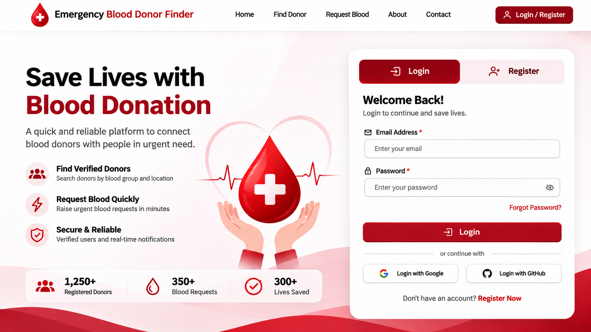
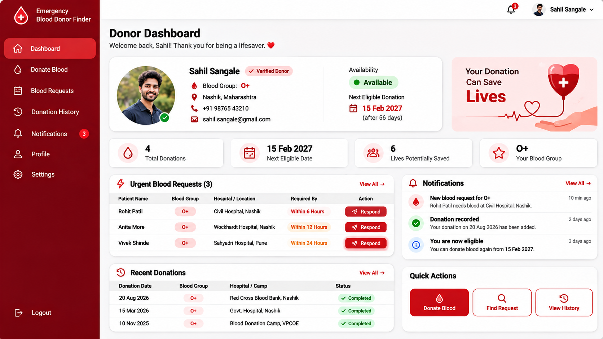
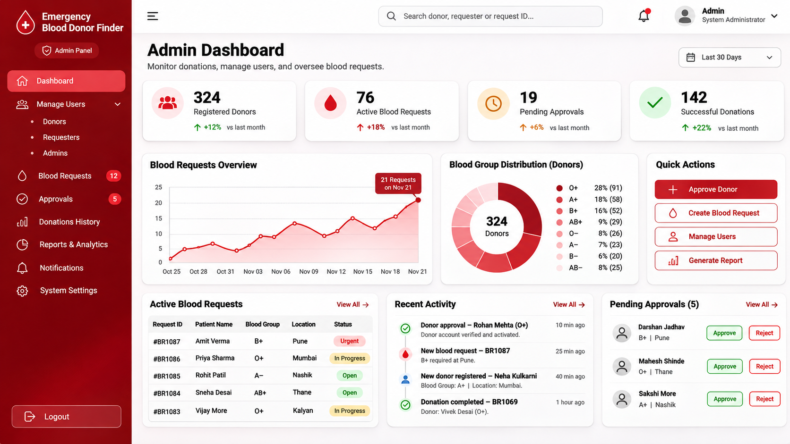
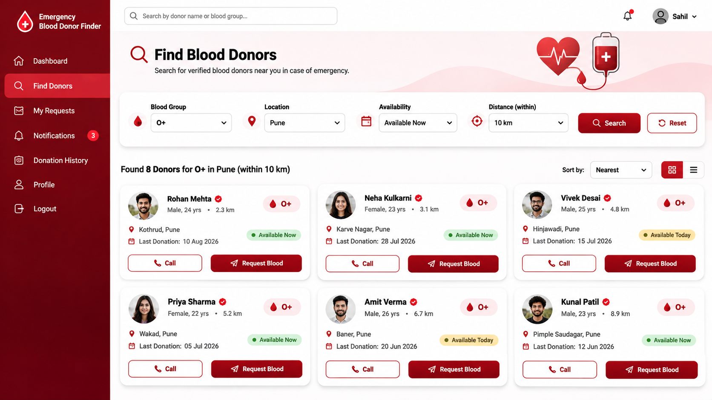
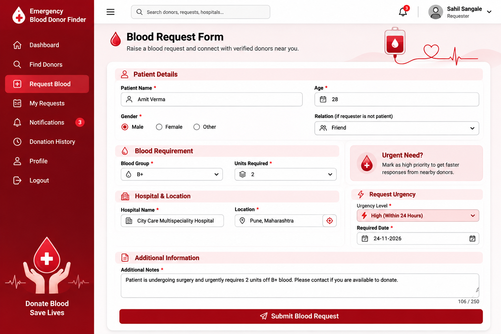

# 🩸 Emergency Blood Donor Finder

A web-based application designed to connect people who urgently need blood with available blood donors. The system helps requesters find compatible donors based on blood group and location, while allowing donors to manage their availability and respond to blood requests.

## 📌 Project Overview

The **Emergency Blood Donor Finder** aims to simplify the process of finding blood donors during medical emergencies.

The application provides separate interfaces for:
- **Donors:** Register, manage profiles, and view blood requests.
- **Requesters:** Submit blood requests and search for compatible donors.
- **Administrators:** Manage users, donors, and blood requests.

## 🚀 Features

### 👤 User Authentication
- User registration and login
- Role-based access for Donor, Requester, and Admin

### 🩸 Donor Module
- Donor profile management
- Blood group information
- Donor availability management
- View blood donation requests

### 🏥 Requester Module
- Submit emergency blood requests
- Search for donors by blood group and location
- View request status

### 🛡️ Admin Module
- Admin dashboard
- Manage donor and requester information
- Monitor blood requests

## 🛠️ Technologies Used

| Technology | Purpose |
|---|---|
| React.js | Frontend development |
| HTML5 | Page structure |
| CSS3 | Styling and responsive UI |
| Java | Backend development |
| Java Servlets | Request handling |
| JDBC | Database connectivity |
| Oracle Database 26ai Free | Database management |
| Apache Tomcat 9 | Application server |
| Maven | Build and dependency management |
| Git & GitHub | Version control |

## 📸 Application Screenshots

The following images are illustrative UI mockups created for the project's interface design.

### 1. Application Overview


### 2. Login and Registration


### 3. Donor Dashboard


### 4. Requester Dashboard


### 5. Admin Dashboard


### 6. Donor Search


### 7. Blood Request Form


## ⚙️ Installation and Setup

### Prerequisites

Install the following software:

- Java JDK 21
- Node.js and npm
- Apache Maven
- Oracle Database 26ai Free
- Apache Tomcat 9
- Git

### 1. Clone the Repository

```bash
git clone https://github.com/sahilsangle24/Emergency-Blood-Donor-Finder.git
```

```bash
cd Emergency-Blood-Donor-Finder
```

### 2. Configure Oracle Database

1. Start Oracle Database.
2. Connect to the `FREEPDB1` pluggable database.
3. Execute the SQL scripts available in the `database` folder.
4. Configure your database connection properties locally.

**Important:** Do not upload database passwords or private configuration files to GitHub.

### 3. Run the Backend

Build the application using Maven:

```bash
mvn clean package
```

Deploy the generated WAR file from the `target` folder to Apache Tomcat 9.

Start the Tomcat server and access the deployed application.

### 4. Run the Frontend

Open a new terminal:

```bash
cd frontend
```

Install dependencies:

```bash
npm install
```

Start the React development server:

```bash
npm run dev
```

Open the local URL displayed in the terminal.

## 📂 Project Structure

```text
EmergencyBloodDonorFinder/
│
├── frontend/                 # React frontend
│
├── src/
│   └── main/
│       ├── java/             # Java Servlet and JDBC code
│       ├── resources/        # Application configuration
│       └── webapp/           # Web application resources
│
├── database/                 # Oracle SQL scripts
│
├── screenshot/               # Application UI mockups
│
├── pom.xml                   # Maven configuration
├── .gitignore
└── README.md
```

## 🔐 Security

- Role-based access control
- Database credentials should be stored outside version control
- Input validation for user-submitted data
- Secure password handling should be configured for production use

## 🎯 Project Objective

The main objective of this project is to reduce the time required to find blood donors during emergencies by providing a centralized platform that connects donors and people in need.

## 👨‍💻 Developer

**Sahil Sangale**

- GitHub: [@sahilsangle24](https://github.com/sahilsangle24)

---

⭐ If you find this project useful, feel free to explore the repository!
